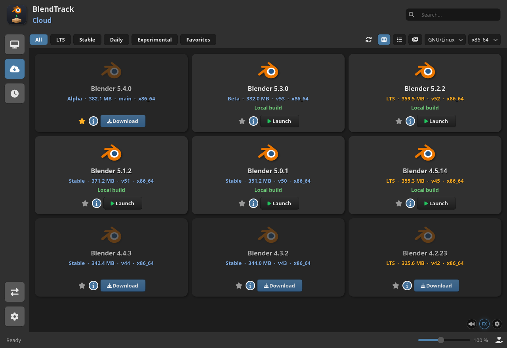
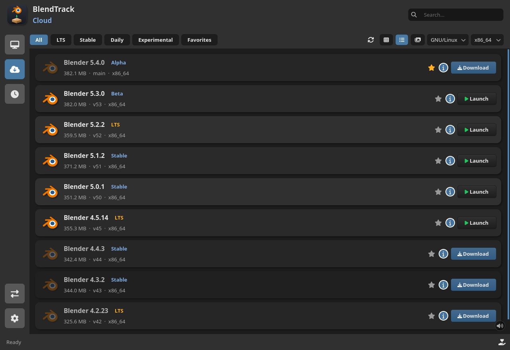
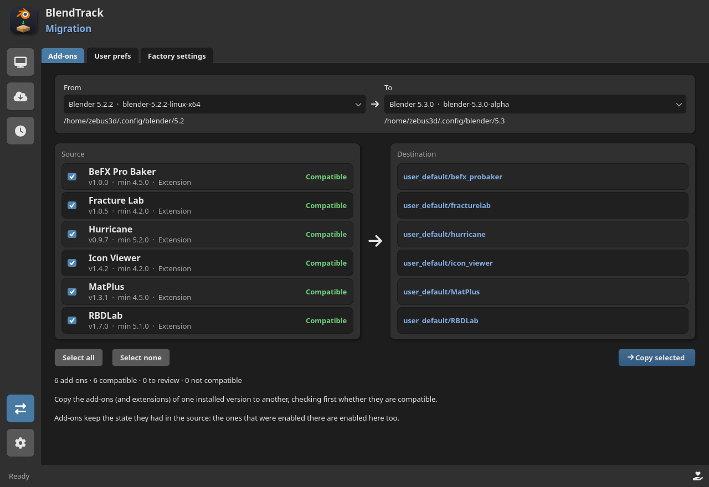

# BlendTrack

BlendTrack keeps every Blender version you use in one place: browse the official
builds (and the Bforartists and UPBGE forks), download the one you want, and
launch or remove it — no browser, nothing to install. It is a single portable
file written in Python with PySide6/Qt.

<p align="center">
  
</p>

<sub>Every build in one screen, with channel tabs, search, and a grid or list
view.</sub>

<p align="center">
  
</p>

<sub>The same store in list view, when you want more versions per screen.</sub>

**Get it:** [latest release](https://github.com/zebus3d/BlendTrack/releases/latest)
— AppImage for Linux, a single `.exe` for Windows, a `.zip` for macOS.

## What it does

- **Browse every official build.** Channel tabs (All, LTS, Stable, Daily,
  Experimental, Favorites), a search box, a grid or list view with a zoom
  slider (`Ctrl +` / `Ctrl -` / `Ctrl 0`) and release notes one click away.
  Star a version and it gathers under Favorites.
- **Bforartists and UPBGE.** Separate programs built on Blender, each with its
  own tab once you enable it in **Settings → Downloads**. They download,
  install and launch like any version, with their own executable and config
  folder, so a Bforartists 5.2 never gets mistaken for a Blender 5.2.
- **Download for any machine.** The app detects your system and architecture,
  but you can also pick Windows, macOS or ARM64. Downloads show progress, are
  checked with SHA-256 and are unpacked for you (`.tar.xz`, `.zip`, or a `.dmg`
  mounted and copied on macOS). A protected destination such as
  `C:\Program Files` asks for permission instead of failing.
- **Move your whole setup to a new version.** A transfer board lists the
  add-ons of an installed version and where each one lands, with a
  compatibility check first: Blender version, platform, Python wheels and
  compiled modules, Blender modules that no longer exist (like `bgl` in 5.0)
  and add-ons written before the 2.80 API change. The enabled state comes
  along, the last migration can be undone, and preferences can be copied whole
  or key by key — only what you changed, shown under Blender's own names.

<p align="center">
  
</p>

<sub>Migrating add-ons between versions, with the verdict shown before anything
is copied.</sub>

- **Several folders, one kind each.** Put LTS on a fast disk and dailies on a
  big one; every kind has a single owner, so a download is never ambiguous.
  Lock a folder to read-only to point the app at versions you installed by
  hand — they are listed, launched and used for migration, but never written
  to. Moving files between folders is safe (copy first, delete the source only
  once the copy is complete), and you can remove every folder if you would
  rather the app warn than quietly pick a destination for you.
- **Keep everything current.** When Blender publishes a same-series patch, an
  inline update is offered; a new major series is offered in a dialog you can
  ignore for that series. BlendTrack updates itself too: the AppImage in place,
  Windows and macOS through a small helper, and a source checkout with
  `git pull --ff-only`.
- **And more.** Factory-reset a version and restore your settings later; open
  recent `.blend` files with the newest version of their series; manage a
  version's add-ons without opening Blender; tray icon and autostart; a
  portable mode that keeps everything next to the executable; a single
  instance (opening the app twice brings the running window to the front); and
  an interface in English, Spanish, Simplified Chinese, Russian, Japanese and
  Brazilian Portuguese, picked from your locale.

## Get BlendTrack

Download the file for your system from the
[latest release](https://github.com/zebus3d/BlendTrack/releases/latest):

| System  | File |
| ------- | ---- |
| Linux   | `BlendTrack-x86_64.AppImage` |
| Windows | `BlendTrack-windows-x86_64.zip` |
| macOS   | `BlendTrack-macos.zip` |

On Linux, make it executable (`chmod +x`) and run it. To get a menu entry,
integrate it with your launcher of choice (Shelly, Gear Lever, AppImageLauncher,
…) — and re-sync that integration after the app updates itself, so the name and
icon refresh.

## Run from source

You need **Python 3.12 or newer**. The only dependency is **PySide6**, which the
launcher installs for you:

```bash
git clone https://github.com/zebus3d/BlendTrack.git
cd BlendTrack
./run.sh
```

By hand:

```bash
python3 -m venv .venv
source .venv/bin/activate        # Windows: .venv\Scripts\activate
pip install -r requirements.txt
python src/main.py
```

The app opens on the store; if you already have versions in the destination it
opens on **Local** instead. The default destination is a `Blenders` folder
inside your Downloads folder (`~/Downloads/Blenders`, `~/Descargas/Blenders` on
Spanish Linux, or wherever the system says Downloads lives). On Windows it is
`%LOCALAPPDATA%\Programs\Blenders` instead: installs stay there for good, and
Downloads is for files you download and then tidy up. Change it in
**Settings → Folders**. A folder created by **Blender Launcher** works as it
is: its `<library>/versions/` subfolder is scanned too.

Useful flags: `--debug` (Python stack goes to the log if it crashes), `--smoke`
(list builds in the console, no window) and `--screenshot out.png`. The log is
`blendtrack.log` in the cache folder — `~/.cache/blendtrack` on Linux,
`~/Library/Caches/BlendTrack` on macOS, `%LOCALAPPDATA%\BlendTrack\cache` on
Windows.

## Developers

```bash
QT_QPA_PLATFORM=offscreen .venv/bin/python -m unittest discover -t . -s tests
```

The UI tests run with Qt's **offscreen** plugin, so they need no display (the
same thing CI does). Packaging uses **PyInstaller**:

```bash
packaging/build.sh             # dist/BlendTrack
packaging/build.sh --appimage  # also dist/BlendTrack-x86_64.AppImage
```

`.github/workflows/build.yml` runs the tests and builds the three binaries.
Every push to `main` refreshes a single rolling pre-release, and promoting it
(Actions → *promote*) turns it into the final release without rebuilding. The
in-app updater only looks at the latest *final* release, so nobody is notified
while a cycle is still in progress. Binaries are downloaded from the Release,
not committed to the repository. The build gotchas worth knowing before touching
the job (the Ubuntu 22.04 choice, the Qt `xcb` plugin, the macOS `.dmg`, the
Windows code-signing situation) are in [`AGENTS.md`](AGENTS.md).

Layout:

```
src/
  main.py          # entry point and arguments
  i18n.py          # translations (texts in locale/)
  model/           # plain data classes (Build, InstalledBuild)
  services/        # API, downloads, extraction, settings, updates... (no Qt)
  ui/              # PySide6 widgets; qss.py holds the whole look
doc/               # architecture guide in Spanish (start at doc/README.md)
tests/             # unit tests (unittest, UI with Qt's offscreen plugin)
packaging/         # PyInstaller spec, AppImage script and icons
run.sh             # development launcher (creates .venv if missing)
```

The code is meant to be read: `services/` knows nothing about Qt, so it can be
tested and understood on its own, and the interface is separated into the
stylesheet (`ui/qss.py`) and the widgets. The guides in [`doc/`](doc/README.md)
walk through the architecture, the Qt concepts and a worked example of adding a
feature.

## How it compares

[Blender Launcher V2](https://github.com/Victor-IX/Blender-Launcher-V2) is the
mature reference for this job, and BlendTrack borrows from it: the idea of using
Blender's official JSON API, the LTS version map, and the two fork sources
(Bforartists' public WebDAV share and UPBGE's GitHub releases).

BlendTrack bets on the opposite: fewer features, but the common flow — find a
build, download it, launch it — with as little friction as possible. That is why
the whole app is one screen you can read at a glance, why it renders on the CPU
instead of OpenGL (so it does not care about your Mesa version), and why on
Linux it is a single AppImage instead of a choice between several downloads.

[Blenderbase](https://github.com/PhysicalAddons/blenderbase-public) covers
similar ground from a different angle (installed versions, add-ons and recent
files in one window, built with Tauri instead of Qt) and adds a feature of its
own, syncing your setup across computers. It is worth a look.

## Privacy

BlendTrack has no accounts, no telemetry and no analytics. See
[PRIVACY.md](PRIVACY.md) for what it stores locally and which servers it talks
to.

## Credits

This project finishes earlier attempts of mine — `BlenderDownloader` in Qt and
an earlier Kivy version (then called *Blender Manager*) — and is inspired by
Blender Launcher V2. The Kivy version worked, but its OpenGL/SDL2 requirement
broke on newer Mesa releases, so the UI was ported to Qt Widgets.

The Blender logo is a trademark of the [Blender Foundation](https://www.blender.org/).
The Bforartists logo comes from the [Bforartists](https://github.com/Bforartists/Bforartists)
project and the UPBGE logo from [UPBGE](https://github.com/UPBGE/upbge), both
GPL-3.0; they identify those forks and all rights stay with their projects.
Icons are from [Font Awesome Free](https://fontawesome.com/) (SIL OFL 1.1).

<!-- Code signing policy (SignPath): OCULTO hasta que aprueben la solicitud.
La peticion fue rechazada, asi que no se anuncia nada que no tengamos. Cuando
SignPath apruebe, descomentar esta seccion (te da la reputacion que piden en
signpath.org/terms) y volver a anadir el bloque POLICY de promote.yml.
- Committers and reviewers: [@zebus3d](https://github.com/zebus3d) (repository owner)
- Approvers: [@zebus3d](https://github.com/zebus3d) (repository owner)
-->

## License

BlendTrack is free software, released under the
[GNU General Public License v3.0](LICENSE).
Copyright (C) 2019-2026 zebus3d.
